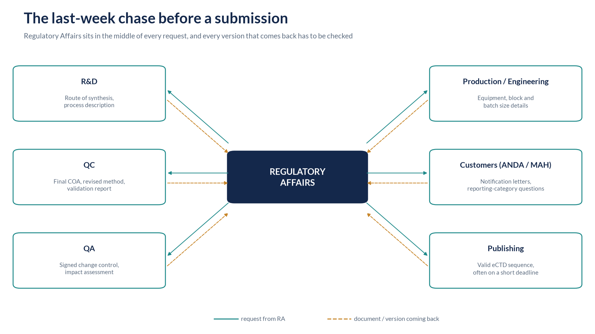
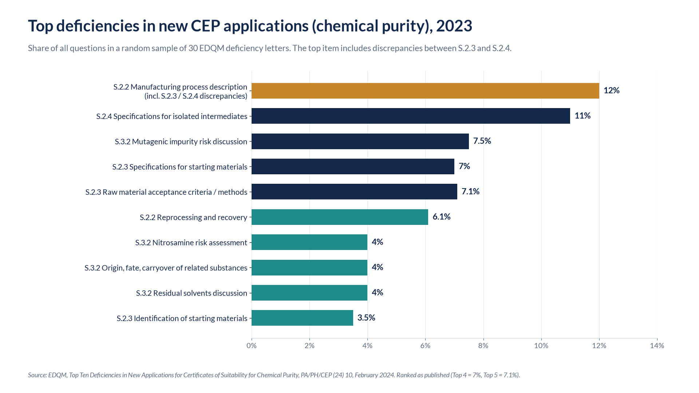
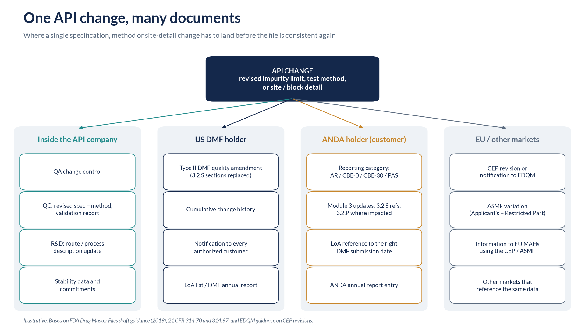
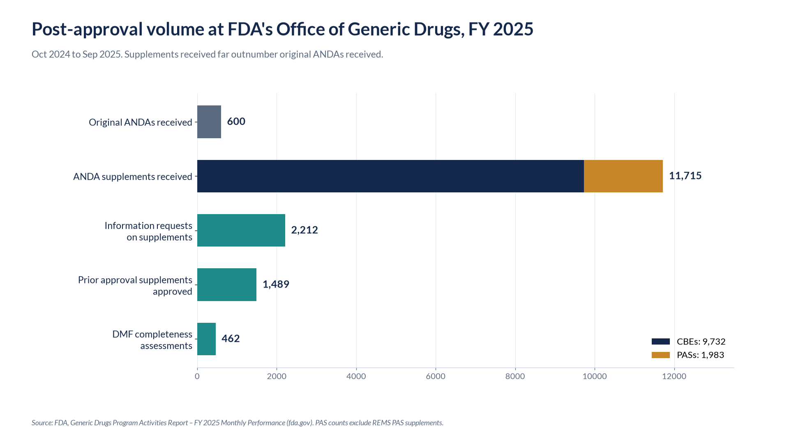
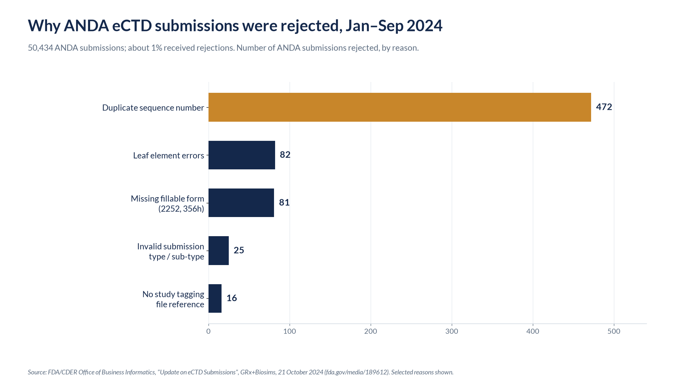

Ask any RA manager about the last week before a submission and you'll hear about chasing documents. The final COA from QC. The signed change control from QA. The method and validation reports. The updated route-of-synthesis description from R&D. The latest stability tables. Equipment and batch details from production.

In conversations with RA teams at API and generic companies in Hyderabad, this comes up more than anything else. The science is rarely the problem; the final documents arrive in the final hours, and that is where errors get in. This article looks at what public data from FDA and EDQM says about where those errors end up.

*RA sits in the middle of every request, and every version that comes back has to be checked.*

## Why the documents arrive late

RA teams describe the same causes again and again.

**Dependencies.** Documents are built on other documents. The validation summary waits for the final method. The specification waits for the validation. The change control can't close until QC, R&D and production have each signed off on their part. A delay at the start of the chain lands on RA at the end.

**Sign-off queues.** A report can be finished and still not be final. It sits in a review and approval queue behind other priorities, and RA can't use a draft.

**Late test results.** Stability time points, a repeat analysis or an investigation can push the final COA or stability table to the last days.

**Moving filing dates.** A customer moves its ANDA filing forward. A market deadline shifts. The plan that gave RA two weeks now gives it two days.

## What goes wrong when documents arrive at the last hour

When documents arrive late, there's no time to check one against another. RA teams describe the same kinds of errors:

- **Wrong or unapproved versions.** What arrives isn't always the version that was approved. A draft COA, an older method or an unsigned report gets into the package.
- **Numbers that don't match across sections.** A limit, a batch size or a result reads one way in one section and another way in the next.
- **Specs updated in one place but not another.** A specification is updated in 3.2.S.4.1, but the method in 3.2.S.4.2 or the validation summary in 3.2.S.4.3 still shows the old version.
- **The DMF, LoA and ANDA disagree.** A site address or block name reads one way in the DMF, another way in the LoA and a third way in a customer's ANDA.
- **No time to cross-check.** Publishing has a few days, sometimes a few hours, to build a valid eCTD sequence.

Regulators see the same patterns. In an April 2026 presentation on ANDA filing review, FDA's Division of Filing Review listed "unclear/typographical errors," "missing stability initiation dates and/or pull dates," "duplicate stability data" and "duplicate executed production records" among the stumbling blocks it finds in Module 3. Missing master production records and missing executed production records are listed as major deficiencies. [[4]](#ref-4)

> **Key insight 1: In the EU, the top CEP deficiency includes inconsistency between sections.** EDQM's analysis of a random sample of 30 deficiency letters from 2023 found that the most frequent issue in new CEP applications for chemical purity was a poor description of the manufacturing process, "including discrepancies noted between the information given in sections S.2.3 and S.2.4." It accounted for 12% of all questions. EDQM notes that assessors check that S.2.2, S.2.3 and S.2.4 are consistent, and that unresolved deficiencies increased the number and complexity of questions and lengthened the time to a certificate. [[8]](#ref-8)

*Top deficiencies in new CEP applications for chemical purity, share of all questions. Source: EDQM, PA/PH/CEP (24) 10.*

An EDQM presentation at its September 2025 CEP conference noted that administrative details, such as site addresses, "are still having a relevant impact on the revisions." [[9]](#ref-9)

## One late change, many documents

One change rarely stays in one file. Take a tighter impurity limit, a revised HPLC method, or a new block at an existing site.

For the DMF holder, that means a quality amendment to the Type II DMF, with the affected 3.2.S sections replaced and the cumulative change history updated. FDA's DMF guidance says holders must notify affected authorized parties of changes. They should give enough information for each customer to decide how to report the change in its own application, and they should do it well before the change is made. [[5]](#ref-5) On the ANDA side, the customer then updates its own Module 3 references and confirms the LoA points to the right DMF submission. If the same API has a CEP or an EU ASMF, the change is classified again under a different system.

If the final documents arrive late, every one of those files is late too.

*One API change touches the API company, the DMF, every customer's ANDA and the EU files.*

> **Key insight 2: A DMF that isn't complete holds up the ANDA that references it.** In the first year of GDUFA, only about 20% of Type II API DMFs undergoing a completeness assessment were found complete on the first cycle. [[10]](#ref-10) By FY 2020, FDA officials said 61% were complete and available for reference in the first review cycle. [[11]](#ref-11) FDA's 2025 presentation on common DMF deficiencies lists incomplete batch analysis data, such as missing batch number, batch size, manufacturing date and site, among the 3.2.S.4 findings. [[12]](#ref-12)

## What the errors cost

**Volume.** In FY 2025, FDA's Office of Generic Drugs received 11,715 ANDA supplements (9,732 CBEs and 1,983 Prior Approval Supplements), against 600 original ANDAs. [[1]](#ref-1)

*Post-approval volume at FDA's Office of Generic Drugs, FY 2025. Source: FDA Generic Drugs Program Activities Report.*

> **Key insight 3: Most ANDAs need more than one review cycle.** GAO found that 12% of the 2,030 generic drug applications FDA reviewed in fiscal years 2015 through 2017 were approved in the first review cycle, and FDA reported an average of three review cycles to approval. [[2]](#ref-2) An FDA analysis presented in April 2025 found that about 38–40% of FY 2018 and FY 2022 ANDAs were approved by the second assessment cycle. [[3]](#ref-3) In FY 2025 alone, OGD issued 1,281 complete response letters and 3,140 information requests on original ANDAs. [[1]](#ref-1)

**Refuse-to-receive.** FDA will refuse to receive an ANDA with one major deficiency or 10 or more minor ones. With fewer than 10 minor deficiencies, FDA may give the applicant 7 calendar days to correct them. [[6]](#ref-6) Refuse-to-receive is far rarer than it was: FDA's RTR guidance records rates of 14%, 10% and 14% of original ANDAs in FY 2013 to FY 2015 [[7]](#ref-7), and OGD issued 18 RTR letters on original ANDAs in FY 2025. [[1]](#ref-1) At an October 2025 industry meeting, OGD officials put the current rate at about 4% and named incomplete stability data, formulation sameness and incomplete or improper Form 356h as the top reasons, as reported by Lachman Consultants. [[13]](#ref-13)

> **Key insight 4: Technical rejections are rare, and most come from assembly, not science.** FDA said it rejected less than 2% of all eCTD submissions in 2022. [[14]](#ref-14) Between 1 January and 30 September 2024, 50,434 ANDA submissions were made and about 1% were rejected. The largest single reason was duplicate sequence numbers (472), followed by leaf element errors (82), missing fillable forms (81) and invalid submission type or sub-type (25). [[15]](#ref-15)

*ANDA eCTD rejections by reason, 1 January to 30 September 2024. Source: FDA/CDER, "Update on eCTD Submissions", October 2024.*

**A CBE-30 that becomes a PAS.** Under 21 CFR 314.70, which applies to ANDAs through 314.97, FDA can tell the applicant within 30 days of receiving a CBE-30 that the change actually needs prior approval. If that happens, product made with the change can't be distributed. [[16]](#ref-16)

**Two deficiency letters in the EU.** EDQM states that a CEP revision application that still lacks sufficient information after the applicant has responded to a maximum of two deficiency letters will be rejected. [[17]](#ref-17)

**GDUFA timelines when filing dates move.** When a DMF is referenced for the first time, FDA's completeness assessment guidance "strongly encourages" holders to submit a complete DMF and pay the fee at least 6 months before the ANDA or PAS that relies on it. [[18]](#ref-18)

## What the data suggests

Read together, the public numbers point in one direction.

- **The front door is mostly fixed. The review cycle isn't.** RTR rates have fallen from double digits to single digits, and eCTD technical rejections sit around 1–2%. But most ANDAs still need more than one cycle. The errors that matter now tend to get through filing and surface later, as information requests and complete response letters.
- **Consistency is a named deficiency, not a side issue.** EDQM's top CEP deficiency explicitly includes discrepancies between S.2.3 and S.2.4. FDA's filing reviewers list typographical errors, missing dates and duplicate data. They are the kind of errors that late, unchecked documents can produce.
- **Upstream gaps travel downstream.** An incomplete DMF delays every ANDA that references it, and the DMF holder's documents become the customer's Module 3. The last-hour problem at an API company becomes a review-cycle problem at its customers.
- **Some routine RA work isn't measured publicly.** There's no public figure for how often documents arrive late, how much RA time goes into chasing them, or how often versions are mismatched. What RA teams describe and what regulators publish point the same way.

## Why we're writing this

Most outside attention goes to the science and the approval. Inside RA, much of the pain sits in the last days before a submission. We want to understand it better from the people who do the work.

So here's our question for RA heads, managers and executives at API and generic companies: **which document most often reaches you at the last hour, and what error does it cause most often?** Please write to us at [contact@rauzr.ai](mailto:contact@rauzr.ai).

## References

<ol class="references">
<li id="ref-1">FDA, Generic Drugs Program Activities Report – FY 2025 Monthly Performance. <a href="https://www.fda.gov/drugs/abbreviated-new-drug-application-anda/generic-drugs-program-activities-report-fy-2025-monthly-performance">https://www.fda.gov/drugs/abbreviated-new-drug-application-anda/generic-drugs-program-activities-report-fy-2025-monthly-performance</a></li>
<li id="ref-2">US GAO, GAO-19-565, Generic Drug Applications: FDA Should Take Additional Steps to Address Factors That May Affect Approval Rates in the First Review Cycle (2019). <a href="https://www.gao.gov/products/gao-19-565">https://www.gao.gov/products/gao-19-565</a></li>
<li id="ref-3">FDA/OGD, "Analysis of Common ANDA Major Deficiencies", Generic Drug Forum, 10 April 2025. <a href="https://www.fda.gov/media/187318/download">https://www.fda.gov/media/187318/download</a></li>
<li id="ref-4">FDA/OGD Division of Filing Review, "Proactive Strategies to Avoid Major Filing Deficiencies &amp; Other Stumbling Blocks", Generic Drugs Forum, 22 April 2026. <a href="https://www.fda.gov/media/194075/download">https://www.fda.gov/media/194075/download</a></li>
<li id="ref-5">FDA, Drug Master Files: Guidance for Industry (draft, Revision 1, October 2019). <a href="https://www.fda.gov/media/131861/download">https://www.fda.gov/media/131861/download</a></li>
<li id="ref-6">FDA, Communicating Certain Deficiencies Identified During Filing Review of ANDAs (MAPP). <a href="https://www.fda.gov/media/107774/download">https://www.fda.gov/media/107774/download</a></li>
<li id="ref-7">FDA, ANDA Submissions – Refuse-to-Receive Standards: Guidance for Industry (Revision 2, December 2016). <a href="https://www.fda.gov/files/drugs/published/ANDA-Submissions----Refuse-to-Receive-Standards-Rev.2.pdf">https://www.fda.gov/files/drugs/published/ANDA-Submissions----Refuse-to-Receive-Standards-Rev.2.pdf</a></li>
<li id="ref-8">EDQM, Top Ten Deficiencies in New Applications for Certificates of Suitability for Chemical Purity, PA/PH/CEP (24) 10, February 2024. <a href="https://www.edqm.eu/documents/52006/66253/Top+Ten+Deficiencies+in+New+Applications+for+Certificates+of+Suitability+for+Chemical+Purity.pdf/934742d6-4d1d-eecf-33ee-e26410b4674a?t=1707402721751">https://www.edqm.eu/documents/52006/66253/Top+Ten+Deficiencies+in+New+Applications+for+Certificates+of+Suitability+for+Chemical+Purity.pdf/934742d6-4d1d-eecf-33ee-e26410b4674a?t=1707402721751</a></li>
<li id="ref-9">EDQM, "CEP 2.0: where do we stand today", Certified for Success conference, September 2025. <a href="https://www.edqm.eu/documents/52006/2270202/2309%201030%20CEP%202.0%20where%20do%20we%20stand%20today%20by%20Andrea%20Melloni.pdf/1f3d8e61-3b60-9f5e-d3af-44470ec5285f?t=1759755882488">https://www.edqm.eu/documents/52006/2270202/2309%201030%20CEP%202.0%20where%20do%20we%20stand%20today%20by%20Andrea%20Melloni.pdf/1f3d8e61-3b60-9f5e-d3af-44470ec5285f?t=1759755882488</a></li>
<li id="ref-10">"Completeness Assessment of Type II Active Pharmaceutical Ingredient Drug Master Files under Generic Drug User Fee Amendment: Review Metrics and Common Incomplete Items", The AAPS Journal (2014). <a href="https://pmc.ncbi.nlm.nih.gov/articles/PMC4147054/">https://pmc.ncbi.nlm.nih.gov/articles/PMC4147054/</a></li>
<li id="ref-11">RAPS, "FDA officials address 'complete assessments' at DMF workshop". <a href="https://www.raps.org/resource/fda-officials-address-complete-assessments-at-dmf.html">https://www.raps.org/resource/fda-officials-address-complete-assessments-at-dmf.html</a></li>
<li id="ref-12">FDA/OPQ, "Common Deficiencies in Drug Master Files (DMFs)", Generic Drug Forum, April 2025. <a href="https://www.fda.gov/media/187320/download">https://www.fda.gov/media/187320/download</a></li>
<li id="ref-13">Lachman Consultants, "More from AAM's GRx+Biosims Meeting", October 2025. <a href="https://www.lachmanconsultants.com/2025/10/more-from-aams-grxbiosims-meeting/">https://www.lachmanconsultants.com/2025/10/more-from-aams-grxbiosims-meeting/</a></li>
<li id="ref-14">FDA/CDER, "Application Submission and Filing Review Process" (eCTD validation). <a href="https://www.fda.gov/media/169451/download">https://www.fda.gov/media/169451/download</a></li>
<li id="ref-15">FDA/CDER, "Update on eCTD Submissions", GRx+Biosims, 21 October 2024. <a href="https://www.fda.gov/media/189612/download">https://www.fda.gov/media/189612/download</a></li>
<li id="ref-16">21 CFR 314.70 and 314.97 (eCFR). <a href="https://www.ecfr.gov/current/title-21/chapter-I/subchapter-D/part-314/subpart-B/section-314.70">https://www.ecfr.gov/current/title-21/chapter-I/subchapter-D/part-314/subpart-B/section-314.70</a> and <a href="https://www.ecfr.gov/current/title-21/chapter-I/subchapter-D/part-314/subpart-C/section-314.97">https://www.ecfr.gov/current/title-21/chapter-I/subchapter-D/part-314/subpart-C/section-314.97</a></li>
<li id="ref-17">EDQM, "Submit changes". <a href="https://www.edqm.eu/en/submit-a-change">https://www.edqm.eu/en/submit-a-change</a></li>
<li id="ref-18">FDA, Completeness Assessments for Type II API DMFs Under GDUFA: Guidance for Industry. <a href="https://www.fda.gov/files/drugs/published/Completeness-Assessments-for-Type-II-API-DMFs-Under-GDUFA-Guidance-for-Industry.pdf">https://www.fda.gov/files/drugs/published/Completeness-Assessments-for-Type-II-API-DMFs-Under-GDUFA-Guidance-for-Industry.pdf</a></li>
</ol>
